# Audifire

Turn any web article or web-novel chapter into an audiobook. Paste a link,
and Audifire pulls out the text, reads it aloud in a natural voice, and
highlights each word as it's spoken. It runs on your own computer, and most
of its voices are free.

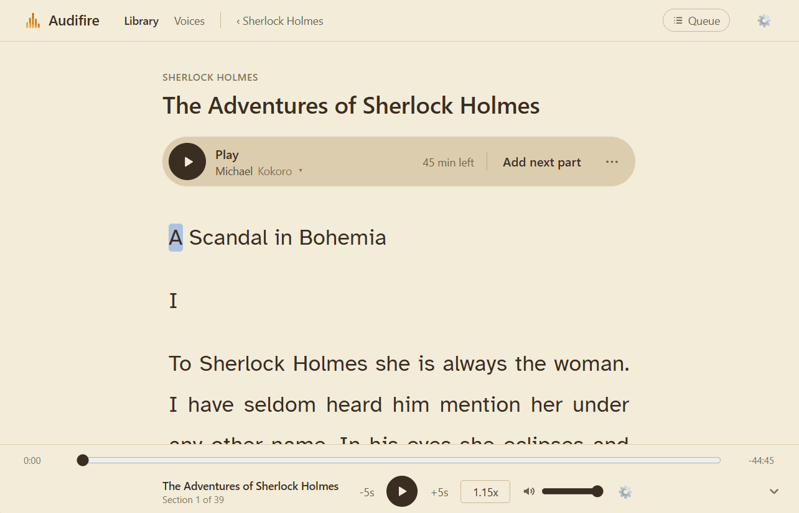

I built it because I listen to long web novels and didn't want to pay a
monthly subscription to do it. Hundreds of chapters later, it's the app I use
every day.

**Highlights**

- **Word-by-word highlighting**, with the page scrolling to keep up.
- **Starts playing in seconds.** Audio is made section by section, so you
  listen to the start while the rest is still being made.
- **Three voice engines:** Kokoro (free, any computer), Qwen3-TTS (free,
  NVIDIA GPU, design your own narrator from a description) and OpenAI (paid).
- **Made for web novels:** collections for each series, "Add next part"
  finds the next chapter for you, progress and time left on every chapter,
  and it remembers where you stopped.
- **Pronunciation fixes** for character names, without changing the text you
  read. Only the sections that used an old spelling are made again.
- **Comfortable reading:** four themes, 15 fonts (including OpenDyslexic and
  Atkinson Hyperlegible), text up to 60 px for listening across the room.
- **Keyboard shortcuts** for everything you do while listening.

## Contents

- [Setup](#setup)
- [Troubleshooting](#troubleshooting)
- [A tour of the app](#a-tour-of-the-app)
- [Under the hood](#under-the-hood)
- [How this would scale](#how-this-would-scale)
- [Tech stack](#tech-stack)
- [Project layout](#project-layout)

## Setup

These steps run Audifire directly on your computer. Commands are for Windows
PowerShell. Where macOS or Linux differ, the difference is noted, and
`curl.exe` is just `curl` there.

**Which voices need what:**

| Voices        | What they need                                                      | Cost                           |
| ------------- | ------------------------------------------------------------------- | ------------------------------ |
| **Kokoro**    | Nothing extra: set up in the steps below, and runs on any CPU       | Free                           |
| **Qwen3-TTS** | An NVIDIA GPU with 4 GB of video memory or more, and Docker Desktop | Free                           |
| **OpenAI**    | An OpenAI API key                                                   | About 1.5¢ per minute of audio |

Kokoro alone is enough to use everything in the app. Qwen and OpenAI can be
added at any time.

### 1. Install the prerequisites

- **Python 3.13.** 3.14 is too new for some of the libraries.
- **Node.js 22** (or 20.19 or newer).
- **PostgreSQL**, any recent version.
- _Optional, for Qwen voices:_ **Docker Desktop** and an **NVIDIA GPU** (see
  [Qwen voices](#optional-qwen-voices-nvidia-gpu)). If your computer can run
  it, it's worth it: Qwen is my personal favorite of the 3, as it sounds quite natural and it's free.

### 2. Get the code

```
git clone https://github.com/fdlai/text_reader.git
cd text_reader
```

### 3. Create the database

```
psql -U postgres -c "CREATE DATABASE text_reader;"
```

(Or create a database named `text_reader` in pgAdmin.)

### 4. Set up the backend

```
cd backend
python -m venv .venv
.venv\Scripts\activate          # macOS/Linux: source .venv/bin/activate
pip install -r requirements.txt
```

If PowerShell refuses to run `activate` ("running scripts is disabled"),
allow it for your user once with
`Set-ExecutionPolicy -Scope CurrentUser RemoteSigned`.

Create your settings file by copying the template, then open `backend/.env`
and put in your PostgreSQL password:

```
copy .env.example .env          # macOS/Linux: cp .env.example .env
```

`.env` is git-ignored, so your password (and API key, if you add one) stays
on your computer.

Download the two Kokoro voice model files (about 350 MB) into
`backend/models/kokoro/`:

```
mkdir models\kokoro
curl.exe -L -o models/kokoro/kokoro-v1.0.onnx https://github.com/thewh1teagle/kokoro-onnx/releases/download/model-files-v1.0/kokoro-v1.0.onnx
curl.exe -L -o models/kokoro/voices-v1.0.bin https://github.com/thewh1teagle/kokoro-onnx/releases/download/model-files-v1.0/voices-v1.0.bin
```

Create the database tables, then start the backend:

```
alembic upgrade head
uvicorn app.main:app --port 8000
```

The first time audio is made, the speech-timing model (Whisper, about
150 MB) downloads itself into `backend/models/whisper/`.

### 5. Start the frontend

In a second terminal:

```
cd frontend
npm install
npm run dev
```

### 6. Try it

1. Open **http://localhost:5173**.
2. Click **New collection** and give it a name, such as the novel you're
   reading.
3. In the collection, paste the web address of an article or chapter into
   **Add an article** and press **Add**.
4. Open the article and press **Play**. With a Kokoro voice, the first
   section is ready in a few seconds, and the rest is made while you listen.

### Starting it again later

You only need the setup once. After that, start the two halves in two
terminals:

```
cd backend
.venv\Scripts\activate          # macOS/Linux: source .venv/bin/activate
uvicorn app.main:app --port 8000
```

```
cd frontend
npm run dev
```

### Optional: OpenAI voices

Create an API key at https://platform.openai.com/api-keys and add it to
`backend/.env`:

```
OPENAI_API_KEY=sk-...
```

Restart the backend afterwards. OpenAI voices are paid (about 1.5 cents per
minute of audio, roughly 90 cents per hour), so setting a monthly budget
limit in your OpenAI account is a good idea.

### Optional: Qwen voices (NVIDIA GPU)

Qwen voices sound great and cost nothing, but they need:

- an **NVIDIA GPU** with at least 4 GB of video memory, and an up-to-date
  driver;
- **Docker Desktop**, running. On Windows it uses WSL 2, which supports the
  GPU.

Download the three model files (about 2.4 GB) into `backend/models/qwen/`:

```
mkdir models\qwen
curl.exe -L -o models/qwen/qwen-talker-1.7b-voicedesign-Q8_0.gguf https://huggingface.co/Serveurperso/Qwen3-TTS-GGUF/resolve/main/qwen-talker-1.7b-voicedesign-Q8_0.gguf
curl.exe -L -o models/qwen/qwen-talker-1.7b-base-Q8_0.gguf https://huggingface.co/Serveurperso/Qwen3-TTS-GGUF/resolve/main/qwen-talker-1.7b-base-Q8_0.gguf
curl.exe -L -o models/qwen/qwen-tokenizer-12hz-Q8_0.gguf https://huggingface.co/Serveurperso/Qwen3-TTS-GGUF/resolve/main/qwen-tokenizer-12hz-Q8_0.gguf
```

There's nothing else to install. The first time you use Qwen, the app
downloads the Qwen Docker image (about 2.6 GB) and copies the models into
Docker. The first sample takes a few minutes; after that, the model starts in
seconds.

Then go to **Voices → Create a voice**, describe a voice, and make samples
until you find one you like. Once saved, it's in every article's voice menu.

The app starts the Qwen container when it's needed and stops it after 5 idle
minutes, so it only uses your GPU while making audio. Qwen makes audio faster
than real time on an RTX 3050 Ti (4 GB), but memory is tight, so closing
other GPU-heavy apps (games, many browser tabs) keeps it fast.

## Troubleshooting

- **"Docker Desktop isn't running"** on the Voices or article page: start
  Docker Desktop, wait until it says it's running, then click **Check again**.
- **Docker Desktop stuck on "Starting the Docker Engine…"** (Windows): quit
  it from the system tray, run `wsl --shutdown` in PowerShell, then start it
  again.
- **"Qwen ran out of GPU memory"**: the app retries by itself with a shorter
  voice sample. If it still fails, close other apps that use the GPU and try
  again.
- **OpenAI says the API key is invalid**, even though `.env` is right: an
  `OPENAI_API_KEY` set as a Windows environment variable overrides `.env`.
  Remove it (System Properties → Environment Variables), then restart your
  terminal or editor.
- **Some sites don't work:** pages that build their text with JavaScript
  after loading, or that block automated requests, can't be read yet.

## A tour of the app

### The Library

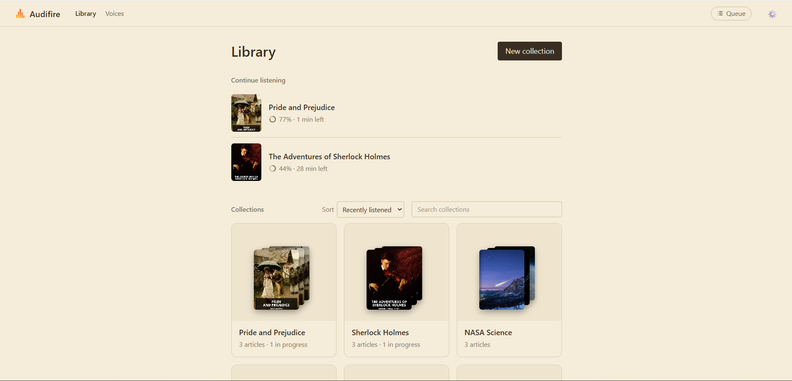

The front page has two parts:

- **Continue listening:** the articles you're partway through, most recent
  first. One click takes you back to where you stopped.
- **Collections**, one card each, showing a stack of the newest covers (it
  fans out when you hover) and a count like "84 articles · 2 in progress".
  Sort them by **Recently listened** or **Name**, or search them. Articles
  that aren't in any collection are in **Unsorted**, at the end.

### A collection

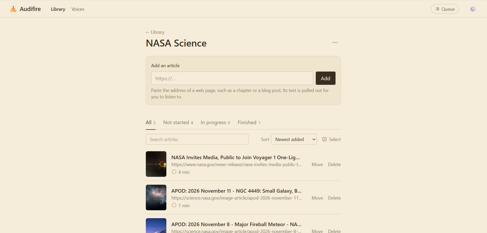

- **Add an article** by pasting its web address. Audifire downloads the page,
  keeps the article and drops menus, ads and comments. It also saves the
  page's cover image. If the page is already in your library, it says which
  collection it's in, with a link to open it.
- **Tabs** split the list into All, Not started, In progress and Finished,
  each with a count, so you can see how many chapters are left at a glance.
- **Sort** by Newest added, Oldest added (chapter order, for a novel) or
  Recently listened, and **search** titles. Long collections are split into
  pages of 50.
- Each article shows its progress ring and time left ("30% · 15 min left").
  The time left comes from how fast that voice actually reads.
- **Select** lets you tick several articles to move or delete them together.
  **Move to…** opens a search-as-you-type picker: start typing to find a
  collection, or create a new one from the same box.
- The **⋯** menu renames or deletes the collection. Deleting asks whether to
  delete its articles too, or keep them in Unsorted. The keep option is the
  one Enter picks.

### Reading and listening

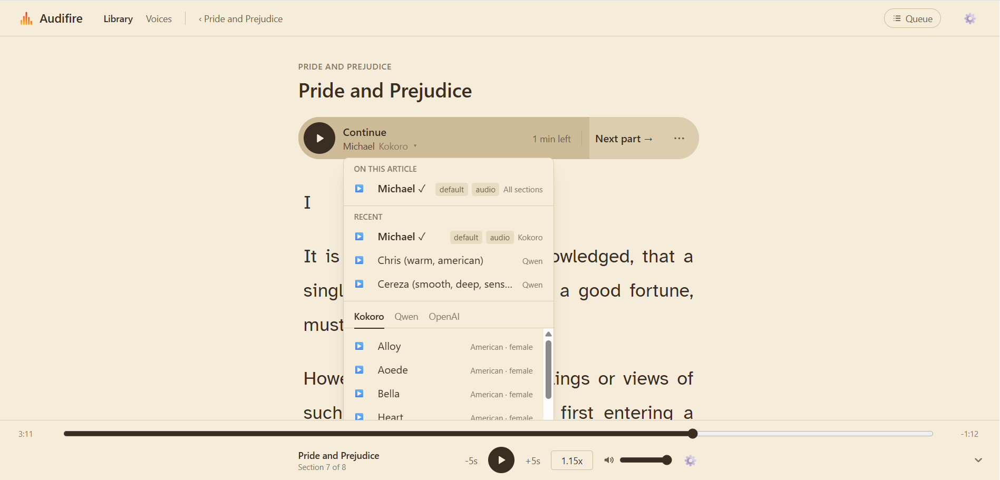

- **The listen bar** at the top of an article has the Play button, the voice
  under it, how long is left (or how far along the audio is), and a **⋯**
  menu for moving the article, opening the original page or deleting a
  voice's audio.
- **The voice menu** has a tab for each engine and a ▶ sample for every
  voice. **On this article** lists the voices that already have audio for
  this article, such as "All sections" or "6 of 14 sections", so you never
  have to hunt for them. Each article remembers the voice you last listened
  with.
- **The highlight follows the voice word by word**, and the page scrolls to
  keep up, a screenful at a time or in small steps (your choice). Scroll
  away and it stops following; **Back to current** brings you back.
- **Select any text** to get **▶ Play from here**, or **Fix pronunciation**
  for a name the voice gets wrong.
- **Next part:** if the page links to a next chapter, **Add next part** adds
  it to the same collection, with the same voice, and starts making its
  audio behind the current one. At the end of a chapter, a pill offers
  **Listen again** or **Next part →**.
- **Outdated audio:** if you change a pronunciation or the pause between
  paragraphs, a banner says how many sections were made with the old
  settings and offers to make just those again. Nothing is remade without
  asking.

### The player bar

The player stays at the bottom of the screen on every page, so you can keep
listening while you browse.

- The progress bar treats the whole article as one recording, even though
  it's made of many sections. Parts that aren't made yet have an estimated
  length, marked with "~".
- Times count real time: at 2× speed, a 10-minute article shows 5:00.
- **±5 seconds** buttons (about a sentence), **speed** from 0.5× to 3×
  (remembered for each voice), and volume.
- **Hide it** (⌄ or H) to leave just a small play button and a thin progress
  line you can drag.

### Voices

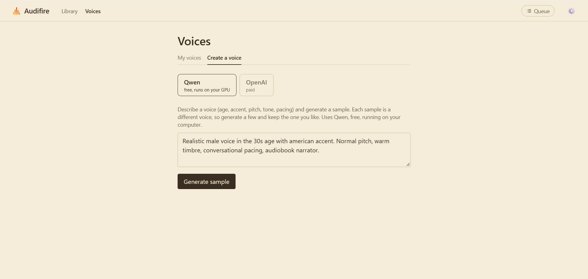

- **My voices** lists your voices, with a sample of each.
- **Create a voice**:
  - **Qwen:** describe a narrator ("male, 40s, American accent, deep and
    calm") and press Generate. Each press makes a new take, and earlier takes
    stay listed so you can compare them. Save the one you like.
  - **OpenAI:** pick a base voice and write style instructions ("warm,
    relaxed narrator"). Previews are kept, so replaying one costs nothing.
- Kokoro's 28 voices are built in and ready in every voice menu.

### Preferences

Press **P** or the ⚙ button, on any page.

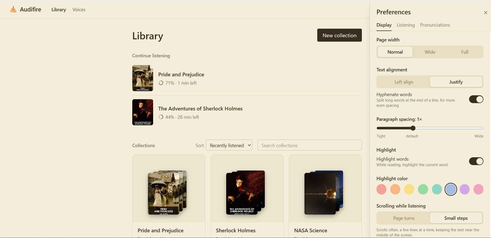

- **Display:** theme (Auto, Light, Dark or Paper), font, text size, page
  width, alignment, hyphenation, paragraph spacing, highlight color, and how
  the page scrolls while following.

  <p>
    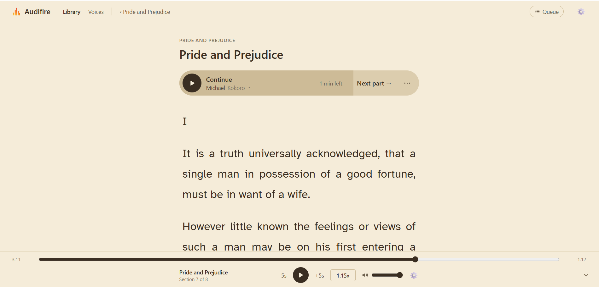
    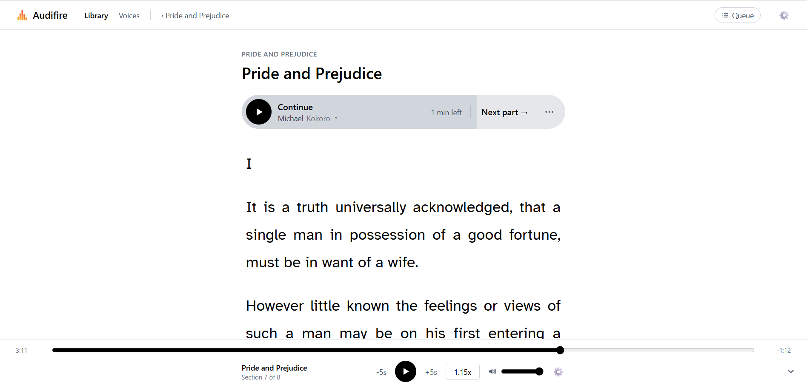
    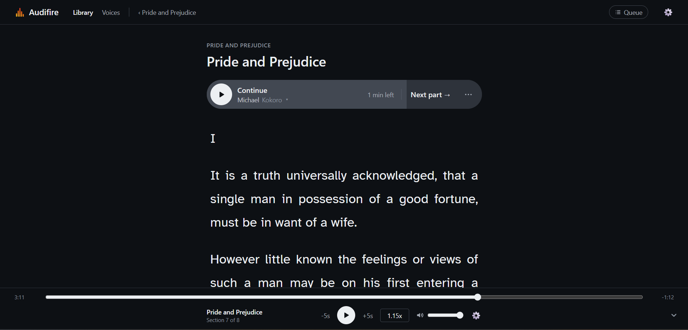
  </p>

- **Listening:** the default voice for new articles, and the pause between
  paragraphs, with a short preview conversation to hear the difference.
  In dialogue-heavy novels, a clear pause makes a change of speaker
  audible.
- **Pronunciations:** respell names so the voices say them right, such as
  "Hermione" → "Her-my-oh-nee". Only the text sent to the voice changes,
  never the text you read. **▶ Original** plays the uncorrected word for
  comparison.

### The generation queue

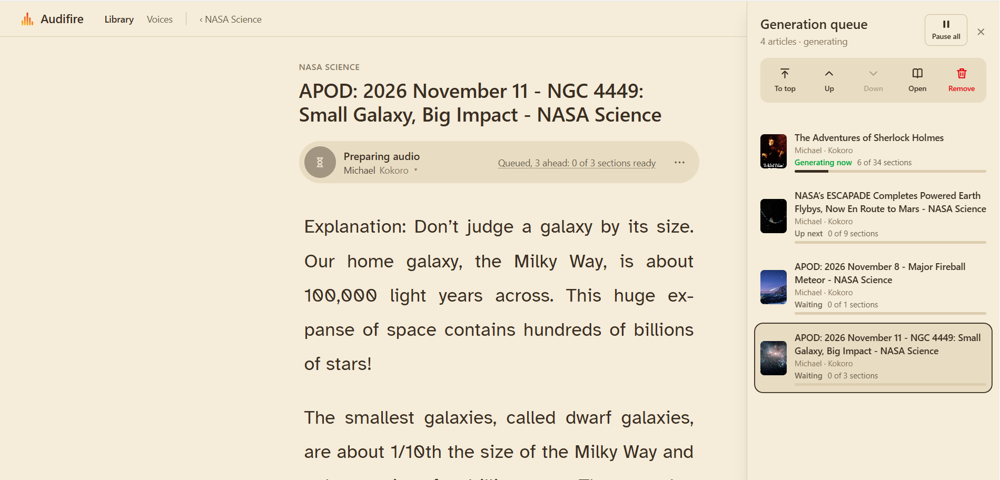

Audio is made one section at a time, from one queue. The **Queue** button in
the header shows how many articles are waiting ("Queue · 3") and opens the
queue panel:

- Select an article, then move it to the top, up or down, open it, or remove
  it.
- Whatever you press Play on jumps to the front.
- **Pause all** stops making audio and frees the GPU straight away. The
  header shows "Paused" until you resume, so a pause is never forgotten.

### Keyboard shortcuts

| Key                       | Where         | Action                      |
| ------------------------- | ------------- | --------------------------- |
| Space                     | Article page  | Play or pause               |
| ← / →                     | Article page  | Back or forward 5 seconds   |
| L                         | Article page  | Back to its collection      |
| P                         | Anywhere      | Preferences                 |
| M                         | While playing | Mute                        |
| H                         | While playing | Hide or show the player bar |
| ↑ ↓, Alt+↑ ↓, Delete, Esc | Queue panel   | Select, move, remove, close |

Shortcuts are ignored while you're typing in a box, and with Ctrl held, so
Ctrl+P still prints.

## Under the hood

Some of the problems that took the most thought, and how they were solved.

### Highlighting words when no engine gives word timings

None of the three voice engines report when each word is spoken. So after a
section is made, a local speech-recognition model (faster-whisper) listens to
it and writes down the words it hears, with times. Those are lined up with
the real text (`difflib`). Matched words take Whisper's times, and the rest
are spread between their neighbours by length, never going backwards. One
method works for every engine.

Getting this reliable meant fixing real failures, each found by listening:

- **A stutter ("n-no.") sent Whisper into a loop:** it wrote "No." 11 times
  and skipped about 40 seconds of speech. Turning off Whisper's habit of
  feeding its own output back in, and trusting only exact matches, took
  matched words in that section from 152 to 213 of 266. The longest stall
  went from 20.1 seconds to 1.7.
- **Whisper sometimes skips whole lines in long audio.** Any run of 4 or
  more unheard words is cut out as a short clip and transcribed again, and
  the retry is kept only if it matches more words.
- **Silence between paragraphs pulled highlights early.** Kokoro and Qwen
  read one paragraph at a time, so the app records exactly where each
  paragraph's speech starts and ends, and pins each paragraph's words inside
  it.

In the browser, a binary search finds the current word, and the highlight is
updated on every animation frame instead of the audio element's four updates
a second.

### Starting in seconds: sections that grow

An article is split into sections that are each made separately. The first is
small (about 300 characters), and each one after is up to 1.25 times bigger,
to a maximum of 1,500 characters.

- The small first section is why playback starts within seconds.
- 1.25 matches Qwen's speed: it makes audio at about 0.75 times real time, so
  each bigger section finishes about when the previous one stops playing. An
  earlier version doubled each section, which suited Kokoro but left 25-second
  gaps with Qwen.
- The 1,500 maximum exists because OpenAI's voice was found to cut long
  inputs short: one 4,000-character section came back as 16 seconds of audio
  instead of about 4 minutes.

### One queue, not twenty parallel jobs

Making audio for 20 articles at once would split one GPU 20 ways, so every
article would generate slower than it plays. Instead, one worker makes one
section from the article at the front, then checks the front again, so
moving an article takes effect within a section. Files are written before
their database row and deleted if anything fails, so a cancel or crash never
leaves stray audio behind.

### A narrator that stays the same voice

Asking Qwen to read each paragraph from a text description made a slightly
different voice every time, so the narrator drifted. Custom voices are now
**designed, then cloned**. One model makes a 10-second sample from your
description. A second model copies that sample's voice for every paragraph,
with a fixed random seed, so the voice is the same in chapter 1 and chapter 700.

### Fitting on a 4 GB laptop GPU

- The design and clone models don't both fit, so one Docker container is
  swapped between them. Design is only used on the Create a voice page, so
  swaps are rare.
- The container starts when needed, stops after 5 idle minutes, and only
  listens on your own computer (127.0.0.1). Leftover containers are cleaned
  up at startup, so a crash can't leave one holding GPU memory.
- **It recovers from running out of memory by itself.** If the GPU is too
  full to learn a voice from its full sample, the app restarts Qwen and
  retries with 8, then 6, 4 and 3 seconds of it. A notice only appears when
  that happens.

### Pronunciations that know what's out of date

- Every saved audio file records the exact pronunciation entries and
  paragraph pause it was made with. Opening an article compares that with
  your current settings, so the app knows precisely which sections are out of
  date and remakes only those, and only when you ask.
- Matching names in the text is a dictionary lookup per word, chosen after
  measuring: with 10,000 entries it takes 0.23 ms per section, where one big
  regular expression took 51 ms.

### Smaller details

- **Saving your place cheaply.** Saving every 5 seconds would be 720 requests
  an hour. Instead it saves 1 second after a pause or skip, every 30 seconds
  while playing, and immediately when the tab is closed (with a request that
  survives the page closing).
- **Reading web pages safely.** The server fetches addresses that users
  type, so it only allows `http` and `https`, checks that every address it
  connects to is public (including after each redirect), and stops at 10
  seconds or 5 MB. SVG images are refused, since they can contain scripts.
- **Deleting in the safe order.** Generation is cancelled first, then the
  database rows are deleted, and the files only after that commits, so a
  failure never deletes files the database still uses.
- **No flash of the wrong theme.** Your display settings are applied before
  the page first draws.
- **Themes without dark-mode classes.** Each theme redefines Tailwind's color
  variables, so every component changes color with no theme-specific code.
- **Popups are native `<dialog>` elements**, which give focus trapping, Esc to
  close and a dimmed background for free. Auto-scroll respects your system's
  reduce-motion setting.

## How this would scale

The app is built for one person on one computer. Here is what limits it, and
how a hosted version for many users would be built.

### What limits it: generating audio, not web requests

Serving pages and audio files is cheap. Generating speech is not:

| Step                          | Runs on                 | Time per second of audio |
| ----------------------------- | ----------------------- | ------------------------ |
| Qwen3-TTS (Q8 model)          | GPU (RTX 3050 Ti, 4 GB) | about 0.75 s             |
| Kokoro                        | CPU                     | about 0.33 s             |
| Word timings (faster-whisper) | CPU                     | about 0.1 s              |

So one small GPU keeps only about **one and a third listeners** ahead of
playback with Qwen. With many users, the question is how to share
generation hardware, not how to handle web traffic.

### Today

- One FastAPI process does everything: it serves the API, runs Kokoro and
  Whisper, and starts and stops the Qwen container.
- One worker generates **one section at a time** from a single queue.
  Running jobs side by side would only split the GPU, so each would play
  slower than it generates. What you're listening to jumps to the front.
- The queue lives in memory. A restart loses it, though each article picks
  up from its first missing section when generated again.
- Audio files are saved on the local disk.

### A hosted version

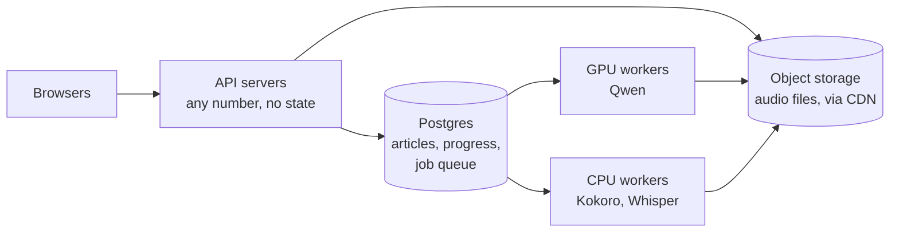

- **API servers only queue jobs.** Pressing "Generate" adds a row to a jobs
  table and returns. API servers keep nothing in memory, so any number can
  run behind a load balancer.
- **Workers are separate programs** on separate machines: GPU machines for
  Qwen, CPU machines for Kokoro and Whisper. Each one repeatedly claims the
  next job, generates one section and saves it. Postgres's
  `SELECT … FOR UPDATE SKIP LOCKED` lets many workers claim jobs from one
  table without two taking the same job, with no extra queue service.
- **The number of workers follows the queue.** Add GPU machines when the
  queue grows and remove them when it's empty. GPUs cost money even when
  idle, so scaling down matters as much as scaling up.
- **Each user has their own order, and users take turns.** Each user still
  sees their own queue, with what they're listening to first. A scheduler
  takes one section from each user in turn and caps how many jobs a user can
  have running, so one person queuing 40 chapters can't hold everyone else
  up. A section is small (seconds to a minute of audio), so taking turns
  per section stays fair.
- **Audio is generated once and shared.** Each saved file already records
  everything it was made from (engine model, pronunciation fixes, paragraph
  pause). Add a hash of the text, and the same chapter with the same voice
  and settings is generated once for everyone who listens to it. Popular
  web-novel chapters would mostly come from this cache.
- **Files go to object storage** (like S3), served through a CDN, so any
  worker can save audio and any server can hand it out.
- **OpenAI needs no workers.** It runs on OpenAI's servers, so requests can
  run in parallel. The limits there are cost and OpenAI's rate limits, so it
  would need a spending cap per user.

### The cost trade-off

At low volume, a paid API (about 1.5 cents per minute of audio) is cheaper
than renting GPUs that sit idle between requests. Above some steady volume,
your own workers cost less per minute. A hosted version would likely start
with the API and add GPU workers as usage grows.

### Going multi-user

Audifire has no accounts, on purpose. It's a personal reader that runs on
your own computer, where signing in would only get in the way. A hosted
version would need accounts, but the sign-in page is the small part. The
larger part is giving every row an owner and making sure every query
respects it.

- **Every user's data gets an owner.** Collections, articles, voices,
  pronunciations and preferences gain a `user_id`. Sections, audio files and
  listening positions belong to an article, so they get its owner through it.
- **Names become unique per user.** Today a collection name, a voice name, a
  pronunciation and an article's web address are each unique across the
  whole database. Each becomes unique per user (`UNIQUE (user_id, name)`),
  so two people can both have a "Favorites" collection or add the same
  chapter.
- **Ownership is enforced in one place.** Instead of every route remembering
  to add `WHERE user_id = …`, a FastAPI dependency supplies the signed-in
  user, and each table's queries go through helpers that always filter by
  it. Asking for someone else's article by its id gets "404 Not Found", not
  "403 Forbidden", so ids don't reveal what exists. Audio and cover images
  are served by routes that make the same check (or by short-lived signed
  links from object storage), not from a public folder.
- **Sessions live in cookies.** Signing in sets an `HttpOnly`, `Secure`,
  `SameSite=Lax` cookie holding a random session id, stored in a sessions
  table so signing out really ends the session. Page scripts can't read the
  cookie, so an injected script can't steal it. A token kept in
  `localStorage` could be stolen that way.
- **Passwords are handled by a tested library, not hand-written code.** That
  covers hashing (Argon2), limits on sign-in attempts, email verification
  and password resets. Signing in with Google or GitHub instead would avoid
  storing passwords at all.
- **The queue and costs are per user**, as described above: each user's own
  order, turns between users, a cap on running jobs and a spending cap for
  OpenAI voices.
- **Existing data moves over in one migration.** Add a nullable `user_id`,
  create the first user, give them every existing row, then make the column
  required.
- **Running it yourself stays sign-in free.** A setting such as
  `AUTH_ENABLED`, off by default, keeps today's experience. With it off,
  every request belongs to one built-in user and no sign-in page appears.
  Many self-hosted apps work this way.

### The first changes in this codebase

1. Move the queue from memory into a Postgres table, so it survives
   restarts. Pause, cancel and "move to front" become updates to that table.
2. Run the worker as its own process, claiming jobs with `SKIP LOCKED`.
3. Save audio through a small storage interface, local disk now and object
   storage later.
4. Give articles, collections, voices and preferences an owner, for user
   accounts (see "Going multi-user"). Preferences are already one row, ready
   to become one row per user.

## Tech stack

- **Frontend:** React 19, Vite, Tailwind CSS v4, React Router 7
- **Backend:** Python 3.13, FastAPI, SQLAlchemy 2 (async) with asyncpg,
  Alembic, Pydantic v2
- **Database:** PostgreSQL
- **Speech:** kokoro-onnx, Qwen3-TTS via
  [qwentts.cpp](https://github.com/ServeurpersoCom/qwentts.cpp) in Docker,
  and OpenAI's gpt-4o-mini-tts
- **Word timings:** faster-whisper
- **Reading web pages:** httpx, trafilatura and lxml

## Project layout

```
backend/
  app/
    main.py           app startup, routes
    models.py         database tables
    schemas.py        request and response shapes (Pydantic)
    routers/          API endpoints (documents, collections, audio,
                      voices, preferences, pronunciations, ...)
    services/         page fetching and text extraction, splitting into
                      sections, speech engines, word timing, the
                      generation queue, Qwen container control
  alembic/            database migrations
  models/             downloaded model files (git-ignored)
  storage/            generated audio, covers and voice samples (git-ignored)
frontend/
  src/
    pages/            Library (Home), Collection, Reader, Voices
    components/       player bar, listen bar, voice menu, panels, popups, ...
    context/          player, generation queue and preferences state
```
